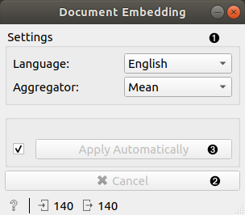
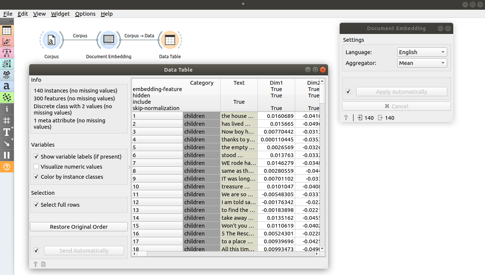
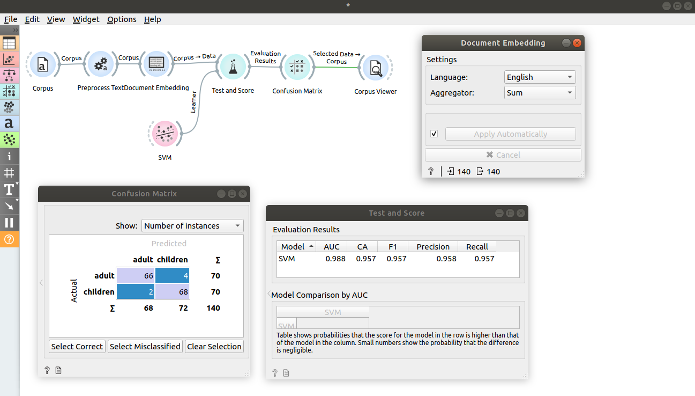

Document Embedding
==================

Embeds documents from input corpus into vector space.

**Inputs**

- Corpus: A collection of documents.

**Outputs**

- Corpus: Corpus with new features appended.

**Document Embedding** parses sentences or n-grams of each document in the corpus, obtains an embedding for each token using a pre-trained model and obtains one vector for each document by aggregating the embeddings using one of the offered aggregators. Note that fastText will work with any n-grams, but it will give the best results if the corpus is preprocessed so that n-grams are words (because the model was trained to embed words).

1. Widget parameters:
    - Language: widget will use a model trained on documents in chosen language.
    - Aggregator: operation to perform on n-gram embeddings to aggregate them into a single document vector.
2. Cancel current execution.
3. If *Apply automatically* is checked, changes in parameters are sent automatically. Alternatively press *Apply*.

Embedding retrieval
-------------------

The two available pre-trained models are [Sentence Bert](https://huggingface.co/sentence-transformers/paraphrase-multilingual-MiniLM-L12-v2) and [fastText](https://fasttext.cc/docs/en/crawl-vectors.html) described in E. Grave et al. (2018).

**SBERT** takes the text sent to the server and embeds each sentence separately, thereby capturing the full semantic profile.

**fastText** takes n-grams (tokens), usually produced by the [Preprocess Text](preprocesstext.md) widget. One can see tokens in the [Corpus Viewer](corpusviewer.md) widget by selecting *Show tokens and tags* or in [Word Cloud](wordcloud.md). Tokens are sent to the server where each token is [vectorized](https://fasttext.cc/docs/en/python-module.html#model-object) separately.

For both models, the aggregation function is used to compute the document embedding. The server returns the vector for each document. Currently, the server runs `paraphrase-multilingual-MiniLM-L12-v2` and `fasttext==0.9.1`. For out-of-vocabulary (OOV) words, fastText obtains vectors by summing up vectors for its component character n-grams.

Examples
--------

In first example, we will inspect how the widget works. Load *book-excerpts.tab* using [Corpus](corpus-widget.md) widget and connect it to **Document Embedding**. Check the output data by connecting **Document Embedding** to **Data Table**. We see additional 300 features that we widget has appended.

In the second example we will try to predict document category. We will keep working on *book-excerpts.tab* loaded with [Corpus](corpus-widget.md) widget and sent through [Preprocess Text](preprocesstext.md) with default parameters. Connect **Preprocess Text** to **Document Embedding** to obtain features for predictive modelling. Here we set aggregator to Sum.

Connect **Document Embedding** to **Test and Score** and also connect learner of choice to the left side of **Test and Score**. We chose SVM and changed kernel to Linear. **Test and Score** will now compute performance of each learner on the input. We can see that we achieved great results.

Let's now inspect confusion matrix. Connect **Test and Score** to **Confusion Matrix**.
Clicking on *Select Misclassified* will output documents that were misclassified. We can further inspect them by connecting [Corpus Viewer](corpusviewer.md) to **Confusion Matrix**.

References
----------

E. Grave, P. Bojanowski, P. Gupta, A. Joulin, T. Mikolov. "Learning Word Vectors for 157 Languages." *Proceedings of the International Conference on Language Resources and Evaluation*, 2018.
